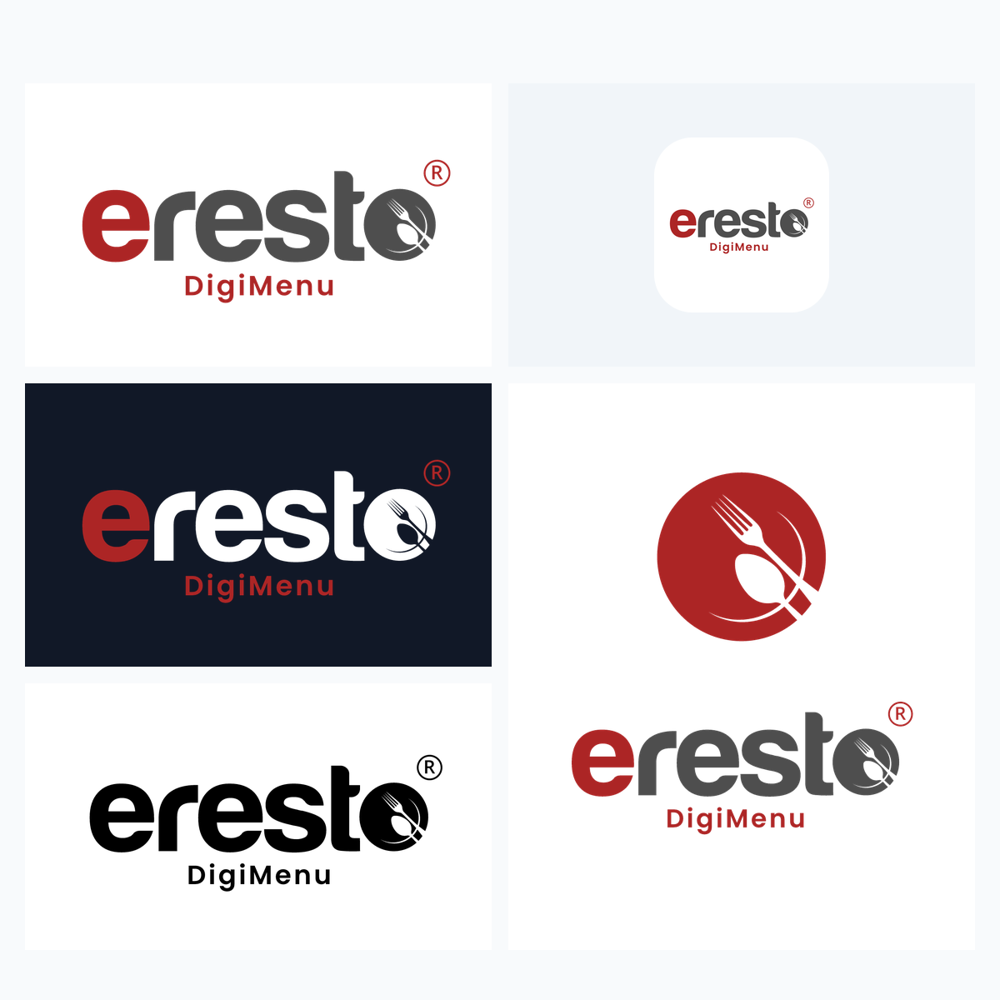

# Eresto DigiMenu — Brand Package v1.0

Official visual identity assets, vectors, and guidelines for **eResto DigiMenu**.

---

## Quick Navigation

- 📘 **Full Specifications**: See [BRAND_GUIDELINES.md](BRAND_GUIDELINES.md)
- 🎨 **Color Codes**: See [06_Brand_Guidelines/Colour_Codes.txt](06_Brand_Guidelines/Colour_Codes.txt)
- 📄 **Guidelines PDF**: See [06_Brand_Guidelines/Eresto_DigiMenu_Brand_Guidelines.pdf](06_Brand_Guidelines/Eresto_DigiMenu_Brand_Guidelines.pdf)

---

## Directory Structure

| Folder | Contents | Formats |
| :--- | :--- | :--- |
| **`01_Master_Logo/`** | Primary horizontal logo for light surfaces | `.svg`, `.png` (2400×600) |
| **`02_White_Version/`** | Reverse white logo & white + red accent for dark surfaces | `.svg`, `.png` |
| **`03_Monochrome/`** | 100% black & grayscale logo for thermal receipts, fax, single-color print | `.svg`, `.png` |
| **`04_Icons/`** | App icon squircle (1024×1024), dish emblem, E monogram, DigiMenu icon | `.svg`, `.png` |
| **`05_Alternate_Layouts/`** | Vertical stacked logos with official product taglines | `.svg`, `.png` (1200×1200) |
| **`06_Brand_Guidelines/`** | Color codes document and print-ready Brand Guidelines PDF | `.txt`, `.pdf` |

---

## Color Codes

- **Eresto Red**: `#D32F2F` | `rgb(211, 47, 47)`
- **Charcoal Gray**: `#424242` | `rgb(66, 66, 66)`
- **Cool Gray**: `#9E9E9E` | `rgb(158, 158, 158)`
- **Light Background**: `#F9F9F9` | `rgb(249, 249, 249)`
- **Typeface**: Poppins (Google Fonts)
- **Tagline**: *"Your Menu. More Possibilities."*
